# .blendファイルの舞台裏 🎬
[English](https://github.com/FarlandGame/Animation-Portfolio/blob/main/sources/blender/en/index.md) · [فارسی](https://github.com/FarlandGame/Animation-Portfolio/blob/main/sources/blender/fa/index.md) · [日本語](https://github.com/FarlandGame/Animation-Portfolio/blob/main/sources/blender/ja/index.md) · [Русский](https://github.com/FarlandGame/Animation-Portfolio/blob/main/sources/blender/ru/index.md)

**Bardiya Alizadeh（Kabir / Farland_game）**による、以前の実験、未完成のシーン、発展途中のアイデアのアーカイブ。現在は新作を優先していますが、いくつかは将来完成させたいと思っています。対象となるオリジナル部分は、作者名を残した非営利の学習・改変・制作継続に利用できます。

> レンダリングには休憩が必要。でもアイデアには休日がないようです。🍿🖥️

28件のファイル項目・25件の制作ファイル配布・残っている場合は以前の保存版も収録。番号は整理用で、制作順や28本の独立した完成作品を示すものではありません。

[開き方・制作の続け方・クレジット](https://github.com/FarlandGame/Animation-Portfolio/blob/main/sources/blender/ja/guide.md) · [CC BY-NC 4.0](https://creativecommons.org/licenses/by-nc/4.0/) · [ポートフォリオ](https://github.com/FarlandGame)

日付はテヘラン時間における提供ファイルの最終更新日です。制作開始日や完成日を確定するものではありません。

## 28件の制作ファイルを見る

| | |
|:--:|:--:|
| <a href="https://github.com/FarlandGame/Animation-Portfolio/blob/main/sources/blender/ja/B01.md">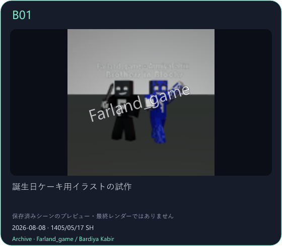</a> [B01 · 誕生日ケーキ用イラストの試作](https://github.com/FarlandGame/Animation-Portfolio/blob/main/sources/blender/ja/B01.md) | <a href="https://github.com/FarlandGame/Animation-Portfolio/blob/main/sources/blender/ja/B02.md">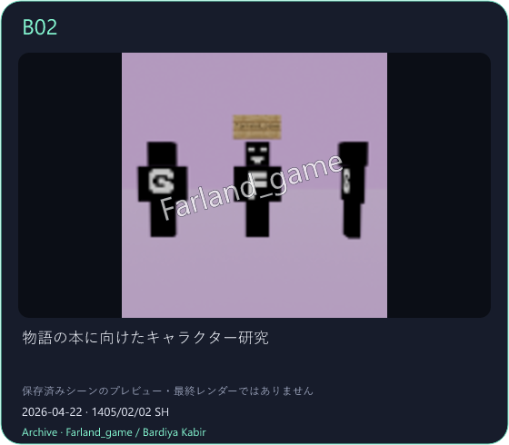</a> [B02 · 物語の本に向けたキャラクター研究](https://github.com/FarlandGame/Animation-Portfolio/blob/main/sources/blender/ja/B02.md) |

| | |
|:--:|:--:|
| <a href="https://github.com/FarlandGame/Animation-Portfolio/blob/main/sources/blender/ja/B03.md">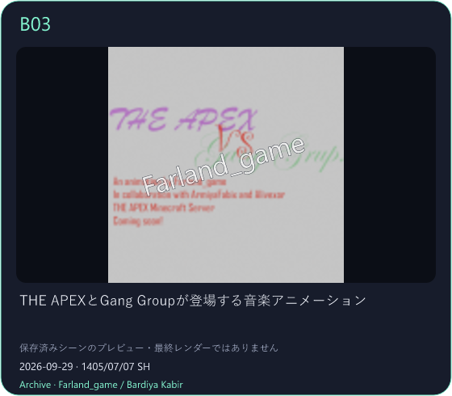</a> [B03 · THE APEXとGang Groupが登場する音楽アニメーション](https://github.com/FarlandGame/Animation-Portfolio/blob/main/sources/blender/ja/B03.md) | <a href="https://github.com/FarlandGame/Animation-Portfolio/blob/main/sources/blender/ja/B04.md">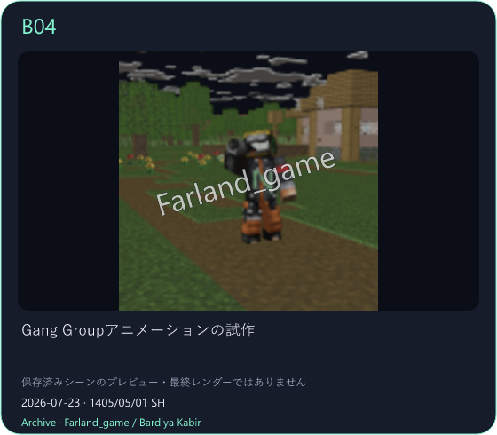</a> [B04 · Gang Groupアニメーションの試作](https://github.com/FarlandGame/Animation-Portfolio/blob/main/sources/blender/ja/B04.md) |

| | |
|:--:|:--:|
| <a href="https://github.com/FarlandGame/Animation-Portfolio/blob/main/sources/blender/ja/B05.md">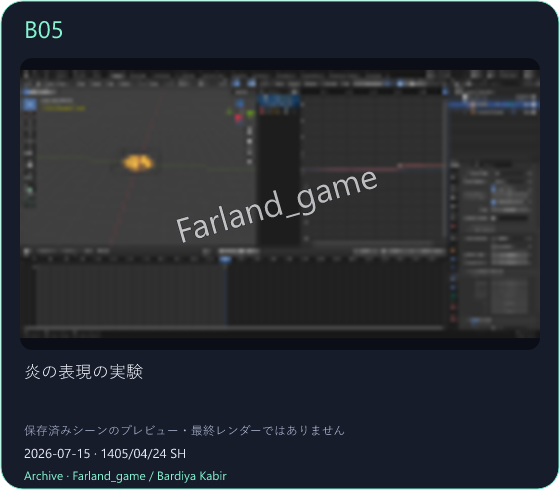</a> [B05 · 炎の表現の実験](https://github.com/FarlandGame/Animation-Portfolio/blob/main/sources/blender/ja/B05.md) | <a href="https://github.com/FarlandGame/Animation-Portfolio/blob/main/sources/blender/ja/B06.md">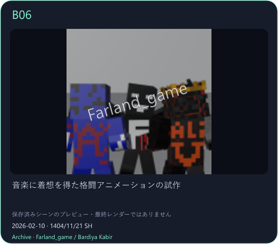</a> [B06 · 音楽に着想を得た格闘アニメーションの試作](https://github.com/FarlandGame/Animation-Portfolio/blob/main/sources/blender/ja/B06.md) |

| | |
|:--:|:--:|
| <a href="https://github.com/FarlandGame/Animation-Portfolio/blob/main/sources/blender/ja/B07.md">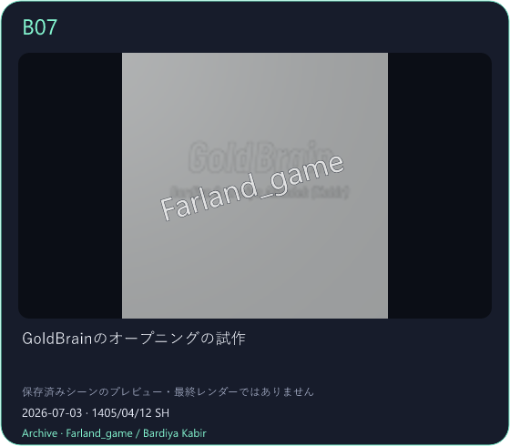</a> [B07 · GoldBrainのオープニングの試作](https://github.com/FarlandGame/Animation-Portfolio/blob/main/sources/blender/ja/B07.md) | <a href="https://github.com/FarlandGame/Animation-Portfolio/blob/main/sources/blender/ja/B08.md">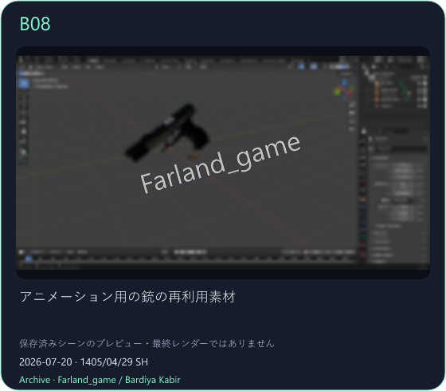</a> [B08 · アニメーション用の銃の再利用素材](https://github.com/FarlandGame/Animation-Portfolio/blob/main/sources/blender/ja/B08.md) |

| | |
|:--:|:--:|
| <a href="https://github.com/FarlandGame/Animation-Portfolio/blob/main/sources/blender/ja/B09.md">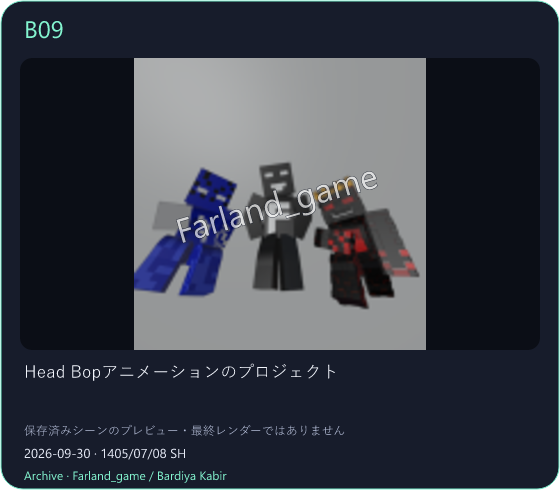</a> [B09 · Head Bopアニメーションのプロジェクト](https://github.com/FarlandGame/Animation-Portfolio/blob/main/sources/blender/ja/B09.md) | <a href="https://github.com/FarlandGame/Animation-Portfolio/blob/main/sources/blender/ja/B10.md">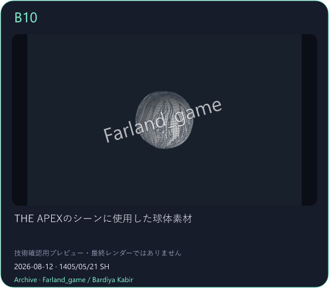</a> [B10 · THE APEXのシーンに使用した球体素材](https://github.com/FarlandGame/Animation-Portfolio/blob/main/sources/blender/ja/B10.md) |

| | |
|:--:|:--:|
| <a href="https://github.com/FarlandGame/Animation-Portfolio/blob/main/sources/blender/ja/B11.md">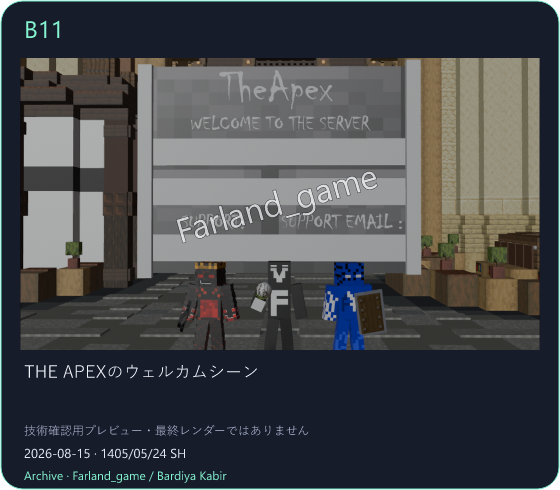</a> [B11 · THE APEXのウェルカムシーン](https://github.com/FarlandGame/Animation-Portfolio/blob/main/sources/blender/ja/B11.md) | <a href="https://github.com/FarlandGame/Animation-Portfolio/blob/main/sources/blender/ja/B12.md">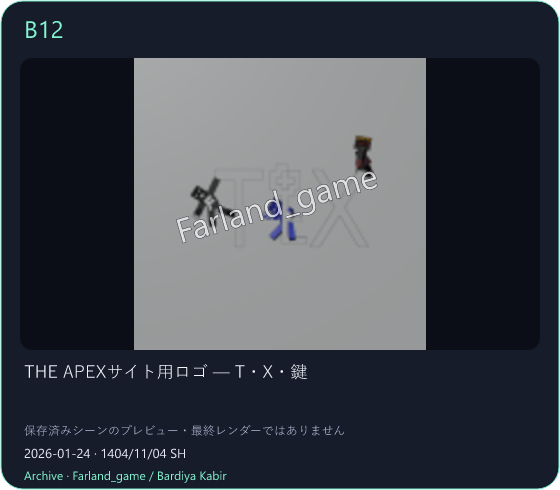</a> [B12 · THE APEXサイト用ロゴ — T・X・鍵](https://github.com/FarlandGame/Animation-Portfolio/blob/main/sources/blender/ja/B12.md) |

| | |
|:--:|:--:|
| <a href="https://github.com/FarlandGame/Animation-Portfolio/blob/main/sources/blender/ja/B13.md">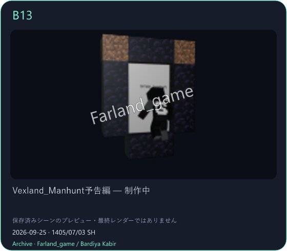</a> [B13 · Vexland_Manhunt予告編 — 制作中](https://github.com/FarlandGame/Animation-Portfolio/blob/main/sources/blender/ja/B13.md) | <a href="https://github.com/FarlandGame/Animation-Portfolio/blob/main/sources/blender/ja/B14.md">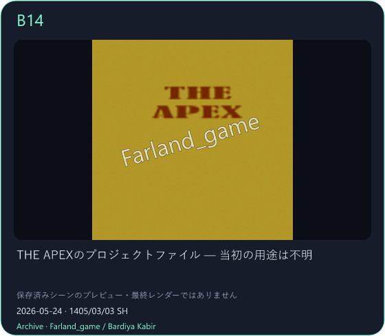</a> [B14 · THE APEXのプロジェクトファイル — 当初の用途は不明](https://github.com/FarlandGame/Animation-Portfolio/blob/main/sources/blender/ja/B14.md) |

| | |
|:--:|:--:|
| <a href="https://github.com/FarlandGame/Animation-Portfolio/blob/main/sources/blender/ja/B15.md">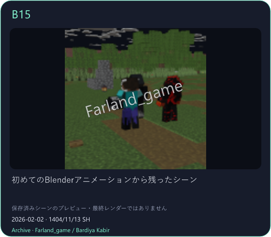</a> [B15 · 初めてのBlenderアニメーションから残ったシーン](https://github.com/FarlandGame/Animation-Portfolio/blob/main/sources/blender/ja/B15.md) | <a href="https://github.com/FarlandGame/Animation-Portfolio/blob/main/sources/blender/ja/B16.md">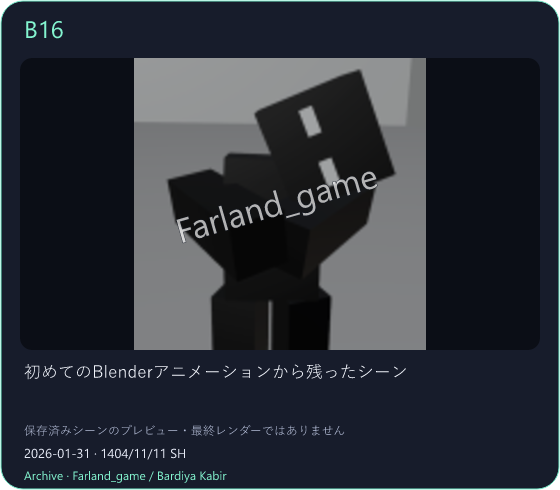</a> [B16 · 初めてのBlenderアニメーションから残ったシーン](https://github.com/FarlandGame/Animation-Portfolio/blob/main/sources/blender/ja/B16.md) |

| | |
|:--:|:--:|
| <a href="https://github.com/FarlandGame/Animation-Portfolio/blob/main/sources/blender/ja/B17.md">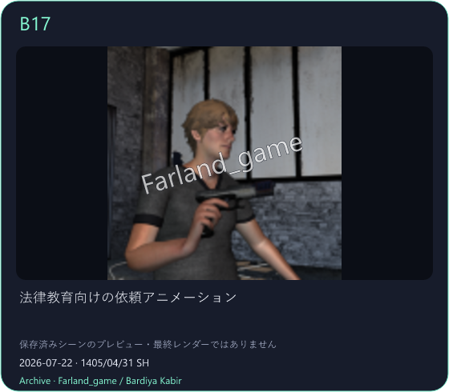</a> [B17 · 法律教育向けの依頼アニメーション](https://github.com/FarlandGame/Animation-Portfolio/blob/main/sources/blender/ja/B17.md) | <a href="https://github.com/FarlandGame/Animation-Portfolio/blob/main/sources/blender/ja/B18.md">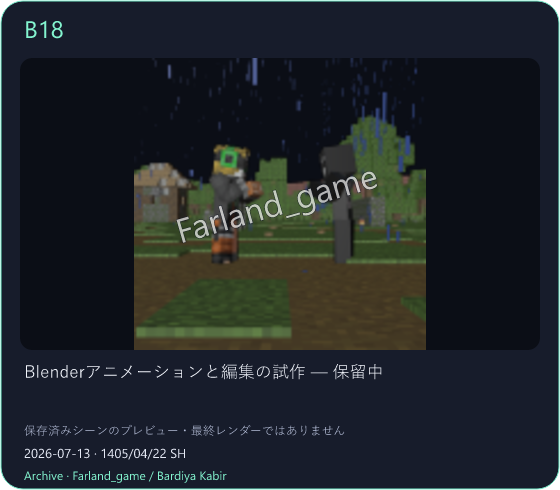</a> [B18 · Blenderアニメーションと編集の試作 — 保留中](https://github.com/FarlandGame/Animation-Portfolio/blob/main/sources/blender/ja/B18.md) |

| | |
|:--:|:--:|
| <a href="https://github.com/FarlandGame/Animation-Portfolio/blob/main/sources/blender/ja/B19.md">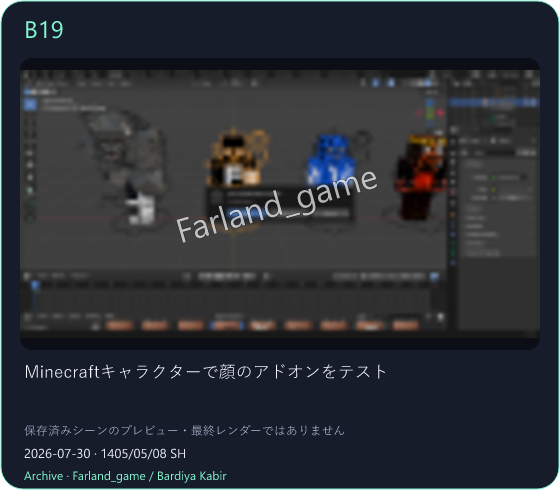</a> [B19 · Minecraftキャラクターで顔のアドオンをテスト](https://github.com/FarlandGame/Animation-Portfolio/blob/main/sources/blender/ja/B19.md) | <a href="https://github.com/FarlandGame/Animation-Portfolio/blob/main/sources/blender/ja/B20.md">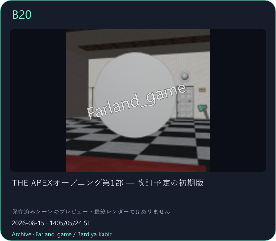</a> [B20 · THE APEXオープニング第1部 — 改訂予定の初期版](https://github.com/FarlandGame/Animation-Portfolio/blob/main/sources/blender/ja/B20.md) |

| | |
|:--:|:--:|
| <a href="https://github.com/FarlandGame/Animation-Portfolio/blob/main/sources/blender/ja/B21.md">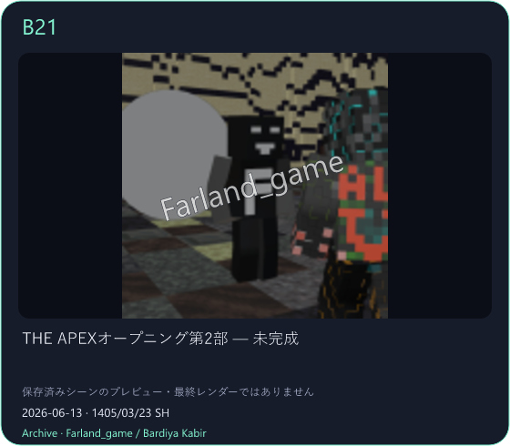</a> [B21 · THE APEXオープニング第2部 — 未完成](https://github.com/FarlandGame/Animation-Portfolio/blob/main/sources/blender/ja/B21.md) | <a href="https://github.com/FarlandGame/Animation-Portfolio/blob/main/sources/blender/ja/B22.md">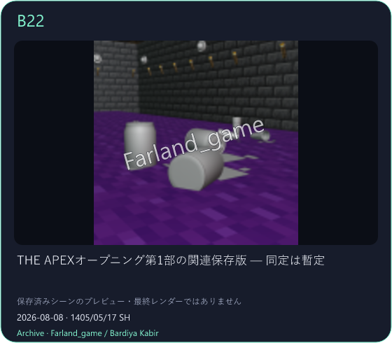</a> [B22 · THE APEXオープニング第1部の関連保存版 — 同定は暫定](https://github.com/FarlandGame/Animation-Portfolio/blob/main/sources/blender/ja/B22.md) |

| | |
|:--:|:--:|
| <a href="https://github.com/FarlandGame/Animation-Portfolio/blob/main/sources/blender/ja/B23.md">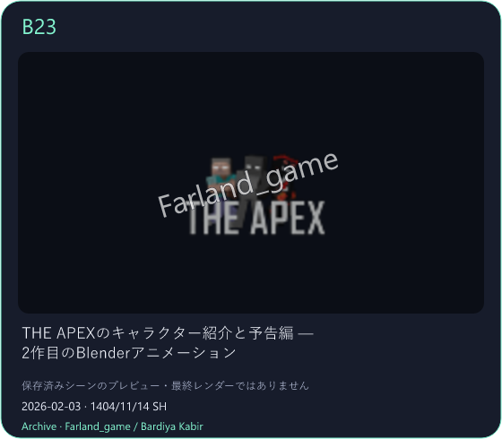</a> [B23 · THE APEXのキャラクター紹介と予告編 — 2作目のBlenderアニメーション](https://github.com/FarlandGame/Animation-Portfolio/blob/main/sources/blender/ja/B23.md) | <a href="https://github.com/FarlandGame/Animation-Portfolio/blob/main/sources/blender/ja/B24.md">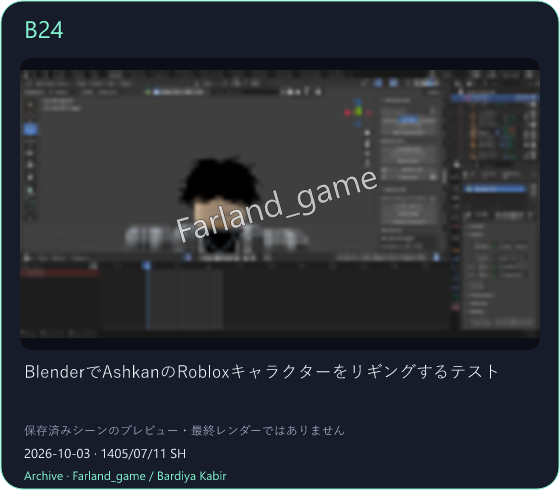</a> [B24 · BlenderでAshkanのRobloxキャラクターをリギングするテスト](https://github.com/FarlandGame/Animation-Portfolio/blob/main/sources/blender/ja/B24.md) |

| | |
|:--:|:--:|
| <a href="https://github.com/FarlandGame/Animation-Portfolio/blob/main/sources/blender/ja/B25.md">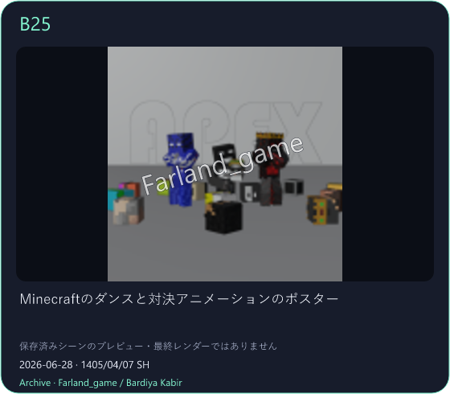</a> [B25 · Minecraftのダンスと対決アニメーションのポスター](https://github.com/FarlandGame/Animation-Portfolio/blob/main/sources/blender/ja/B25.md) | <a href="https://github.com/FarlandGame/Animation-Portfolio/blob/main/sources/blender/ja/B26.md">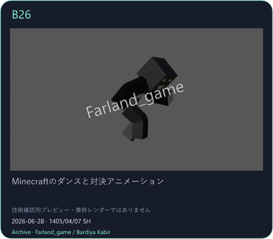</a> [B26 · Minecraftのダンスと対決アニメーション](https://github.com/FarlandGame/Animation-Portfolio/blob/main/sources/blender/ja/B26.md) |

| | |
|:--:|:--:|
| <a href="https://github.com/FarlandGame/Animation-Portfolio/blob/main/sources/blender/ja/B27.md">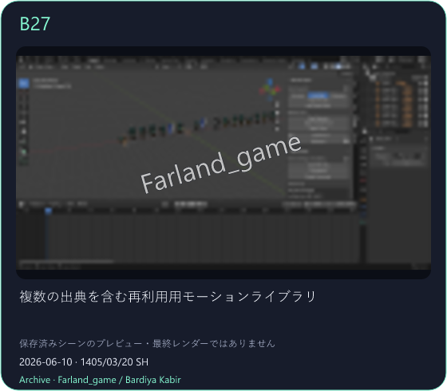</a> [B27 · 複数の出典を含む再利用用モーションライブラリ](https://github.com/FarlandGame/Animation-Portfolio/blob/main/sources/blender/ja/B27.md) | <a href="https://github.com/FarlandGame/Animation-Portfolio/blob/main/sources/blender/ja/B28.md">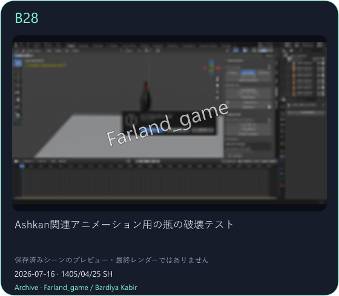</a> [B28 · Ashkan関連アニメーション用の瓶の破壊テスト](https://github.com/FarlandGame/Animation-Portfolio/blob/main/sources/blender/ja/B28.md) |
