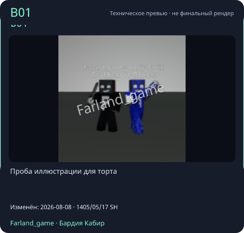

# B01 · Проба иллюстрации для торта
[English](https://github.com/FarlandGame/Animation-Portfolio/blob/main/sources/blender/en/B01.md) · [فارسی](https://github.com/FarlandGame/Animation-Portfolio/blob/main/sources/blender/fa/B01.md) · [日本語](https://github.com/FarlandGame/Animation-Portfolio/blob/main/sources/blender/ja/B01.md) · [Русский](https://github.com/FarlandGame/Animation-Portfolio/blob/main/sources/blender/ru/B01.md)

## Рассказ автора

Бардия подготовил изображение своих и Армии Minecraft-персонажей для печати на праздничном торте. Он испытал аддон, но результат ему не понравился, и изображение не использовали.

**Последнее изменение предоставленного файла:** 2026-08-08 · 1405/05/17 SH

Даты показывают последнее изменение предоставленного файла по времени Тегерана. Они не подтверждают дату начала или окончания проекта.

**Имя предоставленного файла:** `Untitled.blend`

**Исходная сохранённая версия:** 5.2

### [Скачать подготовленный архив исходников · ZIP · 7.2 MB](https://github.com/FarlandGame/Animation-Portfolio/releases/download/blender-source-archive-2026-11/B01-blender-source-snapshot.zip)

Формат публичной копии — Blender 5.2. Совместимость со старыми версиями и полный финальный рендер не гарантированы.

Это отдельно подготовленные копии. Оригиналы на компьютере автора не менялись. Доступные текстуры упакованы; незавершённость, недостающие ресурсы и удалённые сторонние движения явно отмечены как ограничения.

`SHA-256: afd3e97513843de146c30ce4c6ecc348cdcd97a2d883f3e9512cef5bcaba4881`

## Ресурсы и изменения публичной копии

**Недостающие изображения:** При этой проверке не обнаружены

**Удалённые распознанные движения Mixamo:** При этой проверке не обнаружены

**Исключённая музыка:** При этой проверке не обнаружены

**Сохранённое аудио:** При этой проверке не обнаружены

**Внешние шрифты:** `BarlowCondensed-Bold.ttf`, `BAUHS93.TTF`

### Сохранённая предыдущая версия

Предыдущее сохранение находится в папке versions архива. Это не обязательно самостоятельный проект. В загрузку включены хеши и даты предоставленных файлов.

Сохраняйте авторство: **Bardiya Alizadeh (Kabir / Farland_game)**. Подходящие оригинальные материалы распространяются по **CC BY-NC 4.0**: только некоммерческое использование, ссылка на лицензию и указание изменений. Свой вклад отмечайте отдельно. Сторонние ресурсы сохраняют собственные условия.

[Как открыть, продолжить и указать автора](https://github.com/FarlandGame/Animation-Portfolio/blob/main/sources/blender/ru/guide.md) · [Сторонние ресурсы](https://github.com/FarlandGame/Animation-Portfolio/blob/main/sources/blender/THIRD-PARTY.md) · [Все исходные записи](https://github.com/FarlandGame/Animation-Portfolio/blob/main/sources/blender/ru/index.md)
