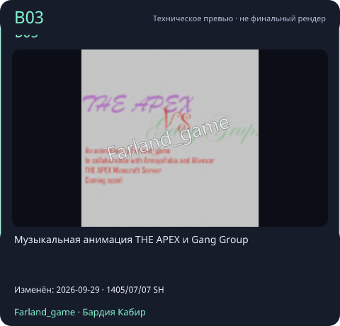

# B03 · Музыкальная анимация THE APEX и Gang Group
[English](https://github.com/FarlandGame/Animation-Portfolio/blob/main/sources/blender/en/B03.md) · [فارسی](https://github.com/FarlandGame/Animation-Portfolio/blob/main/sources/blender/fa/B03.md) · [日本語](https://github.com/FarlandGame/Animation-Portfolio/blob/main/sources/blender/ja/B03.md) · [Русский](https://github.com/FarlandGame/Animation-Portfolio/blob/main/sources/blender/ru/B03.md)

## Рассказ автора

Одна из более поздних анимаций Бардии: музыка, команда THE APEX и персонажи Gang Group.

**Последнее изменение предоставленного файла:** 2026-09-29 · 1405/07/07 SH

Даты показывают последнее изменение предоставленного файла по времени Тегерана. Они не подтверждают дату начала или окончания проекта.

**Имя предоставленного файла:** `untitled.blend`

**Исходная сохранённая версия:** 4.3

### [Скачать подготовленный архив исходников · ZIP · 24.6 MB](https://github.com/FarlandGame/Animation-Portfolio/releases/download/blender-source-archive-2026-11/B03-blender-source-snapshot.zip)

Формат публичной копии — Blender 5.2. Совместимость со старыми версиями и полный финальный рендер не гарантированы.

Это отдельно подготовленные копии. Оригиналы на компьютере автора не менялись. Доступные текстуры упакованы; незавершённость, недостающие ресурсы и удалённые сторонние движения явно отмечены как ограничения.

`SHA-256: 087631e407a9c996dda1d884d2cc1f0eed465a58c203ff3c748d8ea28c71672c`

## Ресурсы и изменения публичной копии

**Недостающие изображения:** При этой проверке не обнаружены

**Удалённые распознанные движения Mixamo:** `SimplePlayer.arma|mixamo.com|Layer0`

**Исключённая музыка:** `ESPECTRO_Ultra_Slowed_DJ_Alex_MC_LOCKED_Dean_Kappert_Aleksa.m4a`

**Сохранённое аудио:** При этой проверке не обнаружены

Внешние шрифты: 8

`AGENCYB.TTF`, `BRUSHSCI.TTF`, `BRUSHSCI.TTF`, `BRUSHSCI.TTF`, `CURLZ___.TTF`, `ITCEDSCR.TTF`, `ITCEDSCR.TTF`, `ITCEDSCR.TTF`

### Сохранённая предыдущая версия

Предыдущее сохранение находится в папке versions архива. Это не обязательно самостоятельный проект. В загрузку включены хеши и даты предоставленных файлов.

Сохраняйте авторство: **Bardiya Alizadeh (Kabir / Farland_game)**. Подходящие оригинальные материалы распространяются по **CC BY-NC 4.0**: только некоммерческое использование, ссылка на лицензию и указание изменений. Свой вклад отмечайте отдельно. Сторонние ресурсы сохраняют собственные условия.

[Как открыть, продолжить и указать автора](https://github.com/FarlandGame/Animation-Portfolio/blob/main/sources/blender/ru/guide.md) · [Сторонние ресурсы](https://github.com/FarlandGame/Animation-Portfolio/blob/main/sources/blender/THIRD-PARTY.md) · [Все исходные записи](https://github.com/FarlandGame/Animation-Portfolio/blob/main/sources/blender/ru/index.md)
