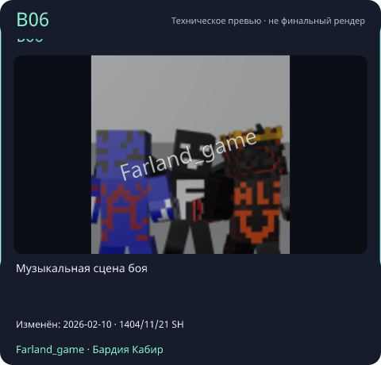

# B06 · Музыкальная сцена боя
[English](https://github.com/FarlandGame/Animation-Portfolio/blob/main/sources/blender/en/B06.md) · [فارسی](https://github.com/FarlandGame/Animation-Portfolio/blob/main/sources/blender/fa/B06.md) · [日本語](https://github.com/FarlandGame/Animation-Portfolio/blob/main/sources/blender/ja/B06.md) · [Русский](https://github.com/FarlandGame/Animation-Portfolio/blob/main/sources/blender/ru/B06.md)

## Рассказ автора

Любимая композиция вдохновила Бардию на анимацию с дракой. Часть сцены была сделана, но сложности с анимацией боя на том этапе остановили работу.

**Последнее изменение предоставленного файла:** 2026-02-10 · 1404/11/21 SH

Даты показывают последнее изменение предоставленного файла по времени Тегерана. Они не подтверждают дату начала или окончания проекта.

**Имя предоставленного файла:** `untitled.blend`

**Исходная сохранённая версия:** 4.3

### [Скачать подготовленный архив исходников · ZIP · 2.0 MB](https://github.com/FarlandGame/Animation-Portfolio/releases/download/blender-source-archive-2026-11/B06-blender-source-snapshot.zip)

Формат публичной копии — Blender 5.2. Совместимость со старыми версиями и полный финальный рендер не гарантированы.

Это отдельно подготовленные копии. Оригиналы на компьютере автора не менялись. Доступные текстуры упакованы; незавершённость, недостающие ресурсы и удалённые сторонние движения явно отмечены как ограничения.

`SHA-256: cc84a40f0c96a2617036996b9fd91c654d655658bbe083628bbe5b3a58712daa`

## Ресурсы и изменения публичной копии

**Недостающие изображения:** При этой проверке не обнаружены

**Удалённые распознанные движения Mixamo:** При этой проверке не обнаружены

**Исключённая музыка:** `HAUNT FUNK (Super Slowed).mp3`

**Сохранённое аудио:** При этой проверке не обнаружены

**Внешние шрифты:** При этой проверке не обнаружены

### Сохранённая предыдущая версия

Предыдущее сохранение находится в папке versions архива. Это не обязательно самостоятельный проект. В загрузку включены хеши и даты предоставленных файлов.

Сохраняйте авторство: **Bardiya Alizadeh (Kabir / Farland_game)**. Подходящие оригинальные материалы распространяются по **CC BY-NC 4.0**: только некоммерческое использование, ссылка на лицензию и указание изменений. Свой вклад отмечайте отдельно. Сторонние ресурсы сохраняют собственные условия.

[Как открыть, продолжить и указать автора](https://github.com/FarlandGame/Animation-Portfolio/blob/main/sources/blender/ru/guide.md) · [Сторонние ресурсы](https://github.com/FarlandGame/Animation-Portfolio/blob/main/sources/blender/THIRD-PARTY.md) · [Все исходные записи](https://github.com/FarlandGame/Animation-Portfolio/blob/main/sources/blender/ru/index.md)
