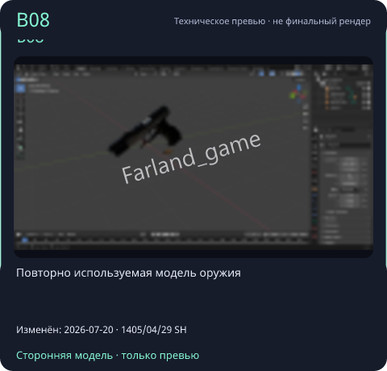

# B08 · Повторно используемая модель оружия
[English](https://github.com/FarlandGame/Animation-Portfolio/blob/main/sources/blender/en/B08.md) · [فارسی](https://github.com/FarlandGame/Animation-Portfolio/blob/main/sources/blender/fa/B08.md) · [日本語](https://github.com/FarlandGame/Animation-Portfolio/blob/main/sources/blender/ja/B08.md) · [Русский](https://github.com/FarlandGame/Animation-Portfolio/blob/main/sources/blender/ru/B08.md)

## Рассказ автора

Файл модели оружия хранился для повторного использования в анимациях, чтобы не скачивать его заново. Это не подтверждение авторства самой сторонней модели; доступно только превью и сведения об источнике.

**Последнее изменение предоставленного файла:** 2026-07-20 · 1405/04/29 SH

Даты показывают последнее изменение предоставленного файла по времени Тегерана. Они не подтверждают дату начала или окончания проекта.

**Имя предоставленного файла:** `untitled.blend`

**Исходная сохранённая версия:** 4.3

## Только превью и ссылка на источник

Загруженная модель оружия; авторство модели не приписывается Бардии. Лицензия на отдельную перераздачу не установлена, поэтому здесь превью без ZIP с моделью.

Сохраняйте авторство: **Bardiya Alizadeh (Kabir / Farland_game)**. Подходящие оригинальные материалы распространяются по **CC BY-NC 4.0**: только некоммерческое использование, ссылка на лицензию и указание изменений. Свой вклад отмечайте отдельно. Сторонние ресурсы сохраняют собственные условия.

[Как открыть, продолжить и указать автора](https://github.com/FarlandGame/Animation-Portfolio/blob/main/sources/blender/ru/guide.md) · [Сторонние ресурсы](https://github.com/FarlandGame/Animation-Portfolio/blob/main/sources/blender/THIRD-PARTY.md) · [Все исходные записи](https://github.com/FarlandGame/Animation-Portfolio/blob/main/sources/blender/ru/index.md)
