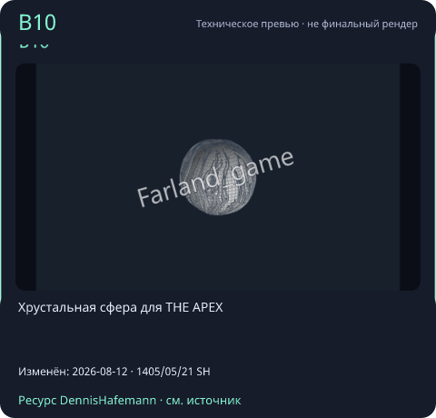

# B10 · Хрустальная сфера для THE APEX
[English](https://github.com/FarlandGame/Animation-Portfolio/blob/main/sources/blender/en/B10.md) · [فارسی](https://github.com/FarlandGame/Animation-Portfolio/blob/main/sources/blender/fa/B10.md) · [日本語](https://github.com/FarlandGame/Animation-Portfolio/blob/main/sources/blender/ja/B10.md) · [Русский](https://github.com/FarlandGame/Animation-Portfolio/blob/main/sources/blender/ru/B10.md)

## Рассказ автора

Сторонний ресурс сферы, использованный в приветственной сцене THE APEX B11. Автор ресурса — DennisHafemann; условия источника сохраняются, файл ресурса здесь не перераздаётся.

**Последнее изменение предоставленного файла:** 2026-08-12 · 1405/05/21 SH

Даты показывают последнее изменение предоставленного файла по времени Тегерана. Они не подтверждают дату начала или окончания проекта.

**Имя предоставленного файла:** `crystal-ball-with-roots-and-vegetation_2K_f5c5d7ac-356d-4af3-94b9-7a3ccb0ba10a.blend`

**Исходная сохранённая версия:** 4.5

## Только превью и ссылка на источник

Сторонняя модель **Dennis Hafemann**, полученная через Blendkit. Встроенные идентификаторы соответствуют первоначальному поставщику. Получайте модель у автора по его собственным условиям royalty-free.

[Crystal Ball With Roots And Vegetation · Dennis Hafemann](https://www.blendkit.com/asset-gallery-detail/982768a1-12a9-4783-93c6-771bb34691d9/)

Сохраняйте авторство: **Bardiya Alizadeh (Kabir / Farland_game)**. Подходящие оригинальные материалы распространяются по **CC BY-NC 4.0**: только некоммерческое использование, ссылка на лицензию и указание изменений. Свой вклад отмечайте отдельно. Сторонние ресурсы сохраняют собственные условия.

[Как открыть, продолжить и указать автора](https://github.com/FarlandGame/Animation-Portfolio/blob/main/sources/blender/ru/guide.md) · [Сторонние ресурсы](https://github.com/FarlandGame/Animation-Portfolio/blob/main/sources/blender/THIRD-PARTY.md) · [Все исходные записи](https://github.com/FarlandGame/Animation-Portfolio/blob/main/sources/blender/ru/index.md)
