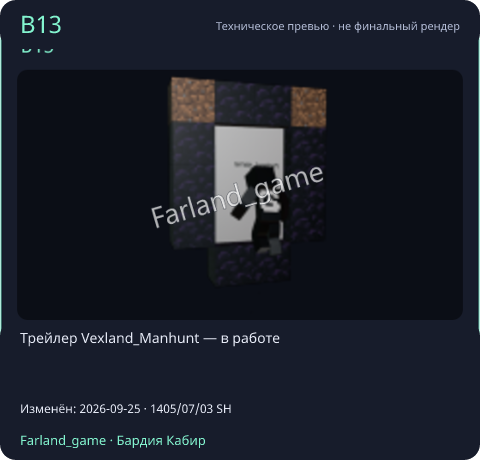

# B13 · Трейлер Vexland_Manhunt — в работе
[English](https://github.com/FarlandGame/Animation-Portfolio/blob/main/sources/blender/en/B13.md) · [فارسی](https://github.com/FarlandGame/Animation-Portfolio/blob/main/sources/blender/fa/B13.md) · [日本語](https://github.com/FarlandGame/Animation-Portfolio/blob/main/sources/blender/ja/B13.md) · [Русский](https://github.com/FarlandGame/Animation-Portfolio/blob/main/sources/blender/ru/B13.md)

## Рассказ автора

Анимированный трейлер плагина Vexland_Manhunt, изначально задуманный длинным. Бардия сделал часть, приостановился в том числе из-за вопросов авторских прав на музыку, но намерен продолжать и закончить. Он разрешил публикацию текущей рабочей версии; отдельно подтвердил право распространять включённую песню.

**Последнее изменение предоставленного файла:** 2026-09-25 · 1405/07/03 SH

Даты показывают последнее изменение предоставленного файла по времени Тегерана. Они не подтверждают дату начала или окончания проекта.

**Имя предоставленного файла:** `Part_1.blend`

**Исходная сохранённая версия:** 5.2

### [Скачать подготовленный архив исходников · RAR · 72.9 MB](https://github.com/FarlandGame/Animation-Portfolio/releases/download/blender-source-archive-2026-11/B13-blender-source-snapshot.rar)

Формат публичной копии — Blender 5.2. Совместимость со старыми версиями и полный финальный рендер не гарантированы.

Это отдельно подготовленные копии. Оригиналы на компьютере автора не менялись. Доступные текстуры упакованы; незавершённость, недостающие ресурсы и удалённые сторонние движения явно отмечены как ограничения.

`SHA-256: a257e5fe68be046f3540b58cbc88d3fe4cd61cbda5df43b78a9d3f8a9ab5dc5e`

## Ресурсы и изменения публичной копии

**Недостающие изображения:** При этой проверке не обнаружены

Удалённые распознанные движения Mixamo: 15

`SimplePlayer.arma.001|mixamo.com|Layer0.001`, `SimplePlayer.arma.001|mixamo.com|Layer0.002`, `SimplePlayer.arma.002|mixamo.com|Layer0`, `SimplePlayer.arma.003|mixamo.com|Layer0`, `SimplePlayer.arma.004|mixamo.com|Layer0.002`, `SimplePlayer.arma|mixamo.com|Layer0`, `SimplePlayer.arma|mixamo.com|Layer0.001`, `SimplePlayer.arma|mixamo.com|Layer0.002`, `SimplePlayer.arma|mixamo.com|Layer0.003`, `SimplePlayer.arma|mixamo.com|Layer0.004`, `SimplePlayer.arma|mixamo.com|Layer0.005`, `SimplePlayer.arma|mixamo.com|Layer0.006`, `SimplePlayer.arma|mixamo.com|Layer0.007`, `SimplePlayer.arma|mixamo.com|Layer0.008`, `SimplePlayer.arma|mixamo.com|Layer0.009`

**Исключённая музыка:** При этой проверке не обнаружены

**Сохранённое аудио:** `LIKE YOU~   ANATHEMA-000.mp3`

Внешние шрифты: 47

`Minecraft.ttf`, `Minecraft.ttf`, `Minecraft.ttf`, `Minecraft.ttf`, `Minecraft.ttf`, `Minecraft.ttf`, `Minecraft.ttf`, `Minecraft.ttf`, `Minecraft.ttf`, `Minecraft.ttf`, `Minecraft.ttf`, `Minecraft.ttf`, `Minecraft.ttf`, `Minecraft.ttf`, `Minecraft.ttf`, `Minecraft.ttf`, `Minecraft.ttf`, `Minecraft.ttf`, `Minecraft.ttf`, `Minecraft.ttf`, `Minecraft.ttf`, `Minecraft.ttf`, `Minecraft.ttf`, `Minecraft.ttf`, `Minecraft.ttf`, `Minecraft.ttf`, `Minecraft.ttf`, `Minecraft.ttf`, `Minecraft.ttf`, `Minecraft.ttf`, `Minecraft.ttf`, `Minecraft.ttf`, `Minecraft.ttf`, `Minecraft.ttf`, `Minecraft.ttf`, `Minecraft.ttf`, `Minecraft.ttf`, `Minecraft.ttf`, `Minecraft.ttf`, `Minecraft.ttf`, `Minecraft.ttf`, `Minecraft.ttf`, `Minecraft.ttf`, `Minecraft.ttf`, `Minecraft.ttf`, `Minecraft.ttf`, `Minecraft.ttf`

### Сохранённая предыдущая версия

Предыдущее сохранение находится в папке versions архива. Это не обязательно самостоятельный проект. В загрузку включены хеши и даты предоставленных файлов.

Сохраняйте авторство: **Bardiya Alizadeh (Kabir / Farland_game)**. Подходящие оригинальные материалы распространяются по **CC BY-NC 4.0**: только некоммерческое использование, ссылка на лицензию и указание изменений. Свой вклад отмечайте отдельно. Сторонние ресурсы сохраняют собственные условия.

[Как открыть, продолжить и указать автора](https://github.com/FarlandGame/Animation-Portfolio/blob/main/sources/blender/ru/guide.md) · [Сторонние ресурсы](https://github.com/FarlandGame/Animation-Portfolio/blob/main/sources/blender/THIRD-PARTY.md) · [Все исходные записи](https://github.com/FarlandGame/Animation-Portfolio/blob/main/sources/blender/ru/index.md)
