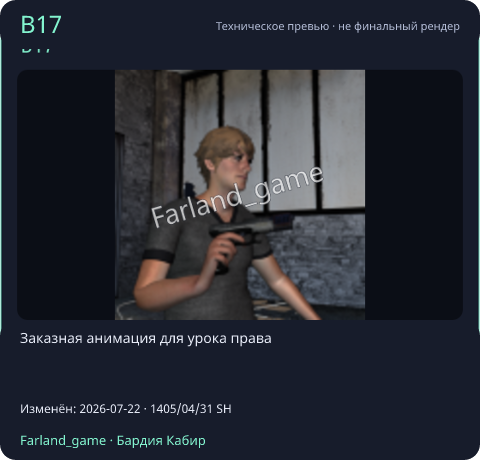

# B17 · Заказная анимация для урока права
[English](https://github.com/FarlandGame/Animation-Portfolio/blob/main/sources/blender/en/B17.md) · [فارسی](https://github.com/FarlandGame/Animation-Portfolio/blob/main/sources/blender/fa/B17.md) · [日本語](https://github.com/FarlandGame/Animation-Portfolio/blob/main/sources/blender/ja/B17.md) · [Русский](https://github.com/FarlandGame/Animation-Portfolio/blob/main/sources/blender/ru/B17.md)

## Рассказ автора

Оплаченный заказ для одного из преподавателей матери Бардии, которая работает юристом. Сцена иллюстрирует учебную ситуацию: персонаж намерен выстрелить вперёд, но из-за дрожания руки выстрел уходит вправо. Анимация предназначалась для объяснения сценария на занятии.

**Последнее изменение предоставленного файла:** 2026-07-22 · 1405/04/31 SH

Даты показывают последнее изменение предоставленного файла по времени Тегерана. Они не подтверждают дату начала или окончания проекта.

**Имя предоставленного файла:** `untitled.blend`

**Исходная сохранённая версия:** 4.3

### Скачать подготовленный архив исходников · RAR × 3 · 275.8 MB

Скачайте **все три тома** в одну папку и начните с **part1.rar**. Это части одного полного пакета, а не разные проекты.

[B17-blender-source-snapshot.part1.rar · 104.9 MB](https://github.com/FarlandGame/Animation-Portfolio/releases/download/blender-source-archive-2026-11/B17-blender-source-snapshot.part1.rar)

`SHA-256: e6060bdb5592d2ff7cf276bc44ba98a5453dc636948cdacc0e4e6eb376ed4932`

[B17-blender-source-snapshot.part2.rar · 104.9 MB](https://github.com/FarlandGame/Animation-Portfolio/releases/download/blender-source-archive-2026-11/B17-blender-source-snapshot.part2.rar)

`SHA-256: 53b08abbb30fc42e1be58310b618f3c7e9f7e2d95d17f21f321b3ae718739890`

[B17-blender-source-snapshot.part3.rar · 66.0 MB](https://github.com/FarlandGame/Animation-Portfolio/releases/download/blender-source-archive-2026-11/B17-blender-source-snapshot.part3.rar)

`SHA-256: 0b8a6c875cd0de09cbef6ecf8f5eb24ea6ff17c5bcb6c42511c3333cadb41789`

Формат публичной копии — Blender 5.2. Совместимость со старыми версиями и полный финальный рендер не гарантированы.

Это отдельно подготовленные копии. Оригиналы на компьютере автора не менялись. Доступные текстуры упакованы; незавершённость, недостающие ресурсы и удалённые сторонние движения явно отмечены как ограничения.

## Ресурсы и изменения публичной копии

**Недостающие изображения:** `Map #1`

Удалённые распознанные движения Mixamo: 6

`Armature.001|mixamo.com|Layer0`, `Armature.002|mixamo.com|Layer0`, `Armature.003|mixamo.com|Layer0`, `Armature.003|mixamo.com|Layer0.001`, `Armature.003|mixamo.com|Layer0.004`, `Armature|mixamo.com|Layer0`

**Исключённая музыка:** При этой проверке не обнаружены

**Сохранённое аудио:** При этой проверке не обнаружены

**Внешние шрифты:** При этой проверке не обнаружены

### Сохранённая предыдущая версия

Предыдущее сохранение находится в папке versions архива. Это не обязательно самостоятельный проект. В загрузку включены хеши и даты предоставленных файлов.

Сохраняйте авторство: **Bardiya Alizadeh (Kabir / Farland_game)**. Подходящие оригинальные материалы распространяются по **CC BY-NC 4.0**: только некоммерческое использование, ссылка на лицензию и указание изменений. Свой вклад отмечайте отдельно. Сторонние ресурсы сохраняют собственные условия.

[Как открыть, продолжить и указать автора](https://github.com/FarlandGame/Animation-Portfolio/blob/main/sources/blender/ru/guide.md) · [Сторонние ресурсы](https://github.com/FarlandGame/Animation-Portfolio/blob/main/sources/blender/THIRD-PARTY.md) · [Все исходные записи](https://github.com/FarlandGame/Animation-Portfolio/blob/main/sources/blender/ru/index.md)
