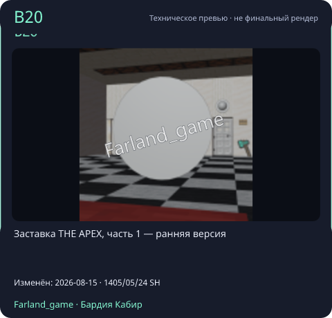

# B20 · Заставка THE APEX, часть 1 — ранняя версия
[English](https://github.com/FarlandGame/Animation-Portfolio/blob/main/sources/blender/en/B20.md) · [فارسی](https://github.com/FarlandGame/Animation-Portfolio/blob/main/sources/blender/fa/B20.md) · [日本語](https://github.com/FarlandGame/Animation-Portfolio/blob/main/sources/blender/ja/B20.md) · [Русский](https://github.com/FarlandGame/Animation-Portfolio/blob/main/sources/blender/ru/B20.md)

## Рассказ автора

Первая из трёх задуманных частей заставки сюжетного Minecraft-эскейпрума THE APEX. Её планировали показывать плагином при начале игры. Ранняя версия отрендерена; Бардия хочет доработать походку и раннюю озвучку. По его памяти, было около 11 000 кадров и примерно 80 дней рендера на ноутбуке. Это стало важным уроком рендера и переноса проектов на другие системы.

**Последнее изменение предоставленного файла:** 2026-08-15 · 1405/05/24 SH

Даты показывают последнее изменение предоставленного файла по времени Тегерана. Они не подтверждают дату начала или окончания проекта.

**Имя предоставленного файла:** `untitled.blend`

**Исходная сохранённая версия:** 5.2

### [Скачать подготовленный архив исходников · ZIP · 22.8 MB](https://github.com/FarlandGame/Animation-Portfolio/releases/download/blender-source-archive-2026-11/B20-blender-source-snapshot.zip)

Формат публичной копии — Blender 5.2. Совместимость со старыми версиями и полный финальный рендер не гарантированы.

Это отдельно подготовленные копии. Оригиналы на компьютере автора не менялись. Доступные текстуры упакованы; незавершённость, недостающие ресурсы и удалённые сторонние движения явно отмечены как ограничения.

`SHA-256: bf55ce633544410d7c8e53cd88c9835cafdc7a54ede6bcd409887dc2e141289f`

## Ресурсы и изменения публичной копии

**Недостающие изображения:** При этой проверке не обнаружены

**Удалённые распознанные движения Mixamo:** При этой проверке не обнаружены

**Исключённая музыка:** При этой проверке не обнаружены

Сохранённое аудио: 12

`1.aac`, `1.mp3`, `2.aac`, `2.mp3`, `3.aac`, `3.mp3`, `4.aac`, `bardia 1.mp3`, `bardiya 2.mp3`, `bardiya 5.mp3`, `bardiya 6.mp3`, `bardiya 8.mp3`

Внешние шрифты: 13

`AGENCYB.TTF`, `AGENCYB.TTF`, `AGENCYB.TTF`, `AGENCYB.TTF`, `AGENCYB.TTF`, `AGENCYB.TTF`, `AGENCYB.TTF`, `AGENCYB.TTF`, `AGENCYB.TTF`, `AGENCYB.TTF`, `AGENCYB.TTF`, `AGENCYB.TTF`, `AGENCYB.TTF`

### Сохранённая предыдущая версия

Предыдущее сохранение находится в папке versions архива. Это не обязательно самостоятельный проект. В загрузку включены хеши и даты предоставленных файлов.

Сохраняйте авторство: **Bardiya Alizadeh (Kabir / Farland_game)**. Подходящие оригинальные материалы распространяются по **CC BY-NC 4.0**: только некоммерческое использование, ссылка на лицензию и указание изменений. Свой вклад отмечайте отдельно. Сторонние ресурсы сохраняют собственные условия.

[Как открыть, продолжить и указать автора](https://github.com/FarlandGame/Animation-Portfolio/blob/main/sources/blender/ru/guide.md) · [Сторонние ресурсы](https://github.com/FarlandGame/Animation-Portfolio/blob/main/sources/blender/THIRD-PARTY.md) · [Все исходные записи](https://github.com/FarlandGame/Animation-Portfolio/blob/main/sources/blender/ru/index.md)
