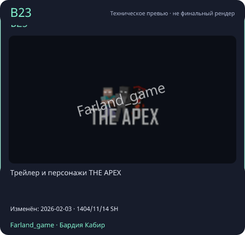

# B23 · Трейлер и персонажи THE APEX
[English](https://github.com/FarlandGame/Animation-Portfolio/blob/main/sources/blender/en/B23.md) · [فارسی](https://github.com/FarlandGame/Animation-Portfolio/blob/main/sources/blender/fa/B23.md) · [日本語](https://github.com/FarlandGame/Animation-Portfolio/blob/main/sources/blender/ja/B23.md) · [Русский](https://github.com/FarlandGame/Animation-Portfolio/blob/main/sources/blender/ru/B23.md)

## Рассказ автора

По словам Бардии, это его вторая анимация, сделанная в Blender: представление персонажей THE APEX и трейлер.

**Последнее изменение предоставленного файла:** 2026-02-03 · 1404/11/14 SH

Даты показывают последнее изменение предоставленного файла по времени Тегерана. Они не подтверждают дату начала или окончания проекта.

**Имя предоставленного файла:** `music vidiyo THE APEX.blend`

**Исходная сохранённая версия:** 4.3

### [Скачать подготовленный архив исходников · ZIP · 4.7 MB](https://github.com/FarlandGame/Animation-Portfolio/releases/download/blender-source-archive-2026-11/B23-blender-source-snapshot.zip)

Формат публичной копии — Blender 5.2. Совместимость со старыми версиями и полный финальный рендер не гарантированы.

Это отдельно подготовленные копии. Оригиналы на компьютере автора не менялись. Доступные текстуры упакованы; незавершённость, недостающие ресурсы и удалённые сторонние движения явно отмечены как ограничения.

`SHA-256: c28fe58bbf22698fe36cd1f1d4cc8491dd4c7f2cc66ac53945d85f13967c56ae`

## Ресурсы и изменения публичной копии

**Недостающие изображения:** `Amir.jpg`, `Super Null.png`, `Super Null.png.003`

**Удалённые распознанные движения Mixamo:** При этой проверке не обнаружены

**Исключённая музыка:** `VAZIO ETERNO (Ultra Slowed).mp3`

**Сохранённое аудио:** При этой проверке не обнаружены

Внешние шрифты: 20

`AGENCYB.TTF`, `AGENCYB.TTF`, `AGENCYB.TTF`, `AGENCYB.TTF`, `AGENCYB.TTF`, `AGENCYB.TTF`, `AGENCYB.TTF`, `ALGER.TTF`, `ALGER.TTF`, `ALGER.TTF`, `ALGER.TTF`, `cambriaz.ttf`, `cambriaz.ttf`, `cambriaz.ttf`, `cambriaz.ttf`, `cambriaz.ttf`, `cambriaz.ttf`, `cambriaz.ttf`, `cambriaz.ttf`, `SHOWG.TTF`

### Сохранённая предыдущая версия

Предыдущее сохранение находится в папке versions архива. Это не обязательно самостоятельный проект. В загрузку включены хеши и даты предоставленных файлов.

Сохраняйте авторство: **Bardiya Alizadeh (Kabir / Farland_game)**. Подходящие оригинальные материалы распространяются по **CC BY-NC 4.0**: только некоммерческое использование, ссылка на лицензию и указание изменений. Свой вклад отмечайте отдельно. Сторонние ресурсы сохраняют собственные условия.

[Как открыть, продолжить и указать автора](https://github.com/FarlandGame/Animation-Portfolio/blob/main/sources/blender/ru/guide.md) · [Сторонние ресурсы](https://github.com/FarlandGame/Animation-Portfolio/blob/main/sources/blender/THIRD-PARTY.md) · [Все исходные записи](https://github.com/FarlandGame/Animation-Portfolio/blob/main/sources/blender/ru/index.md)
