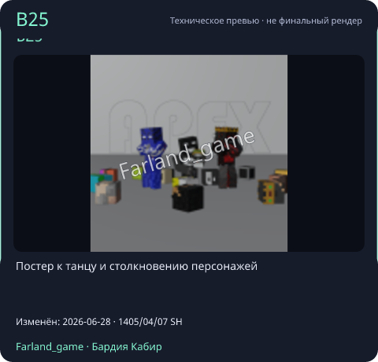

# B25 · Постер к танцу и столкновению персонажей
[English](https://github.com/FarlandGame/Animation-Portfolio/blob/main/sources/blender/en/B25.md) · [فارسی](https://github.com/FarlandGame/Animation-Portfolio/blob/main/sources/blender/fa/B25.md) · [日本語](https://github.com/FarlandGame/Animation-Portfolio/blob/main/sources/blender/ja/B25.md) · [Русский](https://github.com/FarlandGame/Animation-Portfolio/blob/main/sources/blender/ru/B25.md)

## Рассказ автора

Сцена постера для B26: Бардия танцует, появляются Армия и Али, затем следует стилизованное столкновение без крови. По словам автора, итоговые видео и постер уже опубликованы, но отдельный файл монтажа эффектов постера утрачен. В этой сцене нет всех частей финальной обработки.

**Последнее изменение предоставленного файла:** 2026-06-28 · 1405/04/07 SH

Даты показывают последнее изменение предоставленного файла по времени Тегерана. Они не подтверждают дату начала или окончания проекта.

**Имя предоставленного файла:** `untitled.blend`

**Исходная сохранённая версия:** 4.3

### [Скачать подготовленный архив исходников · ZIP · 2.6 MB](https://github.com/FarlandGame/Animation-Portfolio/releases/download/blender-source-archive-2026-11/B25-blender-source-snapshot.zip)

Формат публичной копии — Blender 5.2. Совместимость со старыми версиями и полный финальный рендер не гарантированы.

Это отдельно подготовленные копии. Оригиналы на компьютере автора не менялись. Доступные текстуры упакованы; незавершённость, недостающие ресурсы и удалённые сторонние движения явно отмечены как ограничения.

`SHA-256: 51c93837a9e7743c4f37660804efe0aea3312e00561dabe81a9723a5c55c2431`

## Ресурсы и изменения публичной копии

**Недостающие изображения:** `GunGS_Albedo.tga.png`, `GunGS_Roughness.tga.png`

**Удалённые распознанные движения Mixamo:** При этой проверке не обнаружены

**Исключённая музыка:** При этой проверке не обнаружены

**Сохранённое аудио:** При этой проверке не обнаружены

**Внешние шрифты:** `BAUHS93.TTF`

### Сохранённая предыдущая версия

Предыдущее сохранение находится в папке versions архива. Это не обязательно самостоятельный проект. В загрузку включены хеши и даты предоставленных файлов.

## Ранее опубликованный результат

Автор связал исходники постера и фильма; визуальное сравнение также соответствует опубликованному кадру main-06 и цветному постеру.

[▶ main-06](https://github.com/FarlandGame/Animation-Portfolio/blob/main/collections/en/main.md#main-06) · [THE APEX](https://github.com/FarlandGame/Animation-Portfolio/blob/main/assets/section-covers/the-apex-color.png)

**Related files:** [B26](https://github.com/FarlandGame/Animation-Portfolio/blob/main/sources/blender/ru/B26.md) · [B27](https://github.com/FarlandGame/Animation-Portfolio/blob/main/sources/blender/ru/B27.md)

Сохраняйте авторство: **Bardiya Alizadeh (Kabir / Farland_game)**. Подходящие оригинальные материалы распространяются по **CC BY-NC 4.0**: только некоммерческое использование, ссылка на лицензию и указание изменений. Свой вклад отмечайте отдельно. Сторонние ресурсы сохраняют собственные условия.

[Как открыть, продолжить и указать автора](https://github.com/FarlandGame/Animation-Portfolio/blob/main/sources/blender/ru/guide.md) · [Сторонние ресурсы](https://github.com/FarlandGame/Animation-Portfolio/blob/main/sources/blender/THIRD-PARTY.md) · [Все исходные записи](https://github.com/FarlandGame/Animation-Portfolio/blob/main/sources/blender/ru/index.md)
