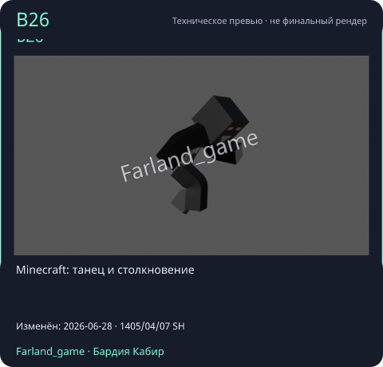

# B26 · Minecraft: танец и столкновение
[English](https://github.com/FarlandGame/Animation-Portfolio/blob/main/sources/blender/en/B26.md) · [فارسی](https://github.com/FarlandGame/Animation-Portfolio/blob/main/sources/blender/fa/B26.md) · [日本語](https://github.com/FarlandGame/Animation-Portfolio/blob/main/sources/blender/ja/B26.md) · [Русский](https://github.com/FarlandGame/Animation-Portfolio/blob/main/sources/blender/ru/B26.md)

## Рассказ автора

Исходник анимации, связанный с постером B25. Бардия танцует, появляются Армия и Али; затем следует стилизованное столкновение без крови. Итоговый ролик и постер уже публиковались. Движения переносились из смешанной библиотеки B27 со сменой скинов; не каждое движение создано Бардией с нуля.

**Последнее изменение предоставленного файла:** 2026-06-28 · 1405/04/07 SH

Даты показывают последнее изменение предоставленного файла по времени Тегерана. Они не подтверждают дату начала или окончания проекта.

**Имя предоставленного файла:** `untitled.blend`

**Исходная сохранённая версия:** 4.3

### [Скачать подготовленный архив исходников · ZIP · 8.3 MB](https://github.com/FarlandGame/Animation-Portfolio/releases/download/blender-source-archive-2026-11/B26-blender-source-snapshot.zip)

Формат публичной копии — Blender 5.2. Совместимость со старыми версиями и полный финальный рендер не гарантированы.

Это отдельно подготовленные копии. Оригиналы на компьютере автора не менялись. Доступные текстуры упакованы; незавершённость, недостающие ресурсы и удалённые сторонние движения явно отмечены как ограничения.

`SHA-256: ef003ffe7af600658a31d7b4985e5a6b1925a16eb1576b0afbc81f7a40c52a0c`

## Ресурсы и изменения публичной копии

**Недостающие изображения:** `GunGS_Albedo.tga.png`, `GunGS_Roughness.tga.png`

Удалённые распознанные движения Mixamo: 34

`SimplePlayer.arma.004|mixamo.com|Layer0`, `SimplePlayer.arma.005|mixamo.com|Layer0`, `SimplePlayer.arma.006|mixamo.com|Layer0`, `SimplePlayer.arma.006|mixamo.com|Layer0.001`, `SimplePlayer.arma.007|mixamo.com|Layer0`, `SimplePlayer.arma.008|mixamo.com|Layer0`, `SimplePlayer.arma.009|mixamo.com|Layer0`, `SimplePlayer.arma.010|mixamo.com|Layer0`, `SimplePlayer.arma.010|mixamo.com|Layer0.001`, `SimplePlayer.arma.011|mixamo.com|Layer0`, `SimplePlayer.arma.012|mixamo.com|Layer0`, `SimplePlayer.arma.012|mixamo.com|Layer0.001`, `SimplePlayer.arma.013|mixamo.com|Layer0`, `SimplePlayer.arma.014|mixamo.com|Layer0`, `SimplePlayer.arma.014|mixamo.com|Layer0.001`, `SimplePlayer.arma.016|mixamo.com|Layer0`, `SimplePlayer.arma.017|mixamo.com|Layer0`, `SimplePlayer.arma.018|mixamo.com|Layer0`, `SimplePlayer.arma.019|mixamo.com|Layer0`, `SimplePlayer.arma.019|mixamo.com|Layer0.001`, `SimplePlayer.arma.020|mixamo.com|Layer0`, `SimplePlayer.arma.021|mixamo.com|Layer0`, `SimplePlayer.arma.022|mixamo.com|Layer0`, `SimplePlayer.arma.024|mixamo.com|Layer0`, `SimplePlayer.arma.025|mixamo.com|Layer0`, `SimplePlayer.arma.025|mixamo.com|Layer0.001`, `SimplePlayer.arma.026|mixamo.com|Layer0`, `SimplePlayer.arma.027|mixamo.com|Layer0`, `SimplePlayer.arma.028|mixamo.com|Layer0`, `SimplePlayer.arma.029|mixamo.com|Layer0`, `SimplePlayer.arma.034|mixamo.com|Layer0`, `SimplePlayer.arma.034|mixamo.com|Layer0.001`, `SimplePlayer.arma.034|mixamo.com|Layer0.002`, `SimplePlayer.arma.034|mixamo.com|Layer0.003`

**Исключённая музыка:** `dança zip (Super Slowed).m4a.001`

**Сохранённое аудио:** При этой проверке не обнаружены

**Внешние шрифты:** При этой проверке не обнаружены

### Сохранённая предыдущая версия

Предыдущее сохранение находится в папке versions архива. Это не обязательно самостоятельный проект. В загрузку включены хеши и даты предоставленных файлов.

## Ранее опубликованный результат

Автор связал исходники постера и фильма; визуальное сравнение также соответствует опубликованному кадру main-06 и цветному постеру.

[▶ main-06](https://github.com/FarlandGame/Animation-Portfolio/blob/main/collections/en/main.md#main-06) · [THE APEX](https://github.com/FarlandGame/Animation-Portfolio/blob/main/assets/section-covers/the-apex-color.png)

**Related files:** [B25](https://github.com/FarlandGame/Animation-Portfolio/blob/main/sources/blender/ru/B25.md) · [B27](https://github.com/FarlandGame/Animation-Portfolio/blob/main/sources/blender/ru/B27.md)

Сохраняйте авторство: **Bardiya Alizadeh (Kabir / Farland_game)**. Подходящие оригинальные материалы распространяются по **CC BY-NC 4.0**: только некоммерческое использование, ссылка на лицензию и указание изменений. Свой вклад отмечайте отдельно. Сторонние ресурсы сохраняют собственные условия.

[Как открыть, продолжить и указать автора](https://github.com/FarlandGame/Animation-Portfolio/blob/main/sources/blender/ru/guide.md) · [Сторонние ресурсы](https://github.com/FarlandGame/Animation-Portfolio/blob/main/sources/blender/THIRD-PARTY.md) · [Все исходные записи](https://github.com/FarlandGame/Animation-Portfolio/blob/main/sources/blender/ru/index.md)
