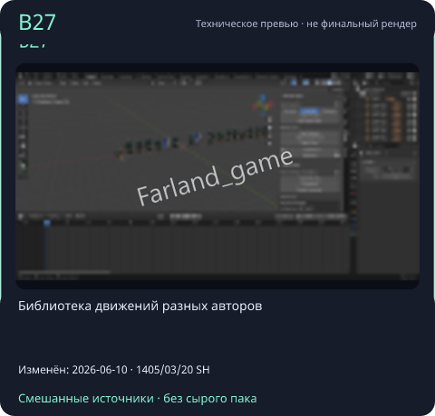

# B27 · Библиотека движений разных авторов
[English](https://github.com/FarlandGame/Animation-Portfolio/blob/main/sources/blender/en/B27.md) · [فارسی](https://github.com/FarlandGame/Animation-Portfolio/blob/main/sources/blender/fa/B27.md) · [日本語](https://github.com/FarlandGame/Animation-Portfolio/blob/main/sources/blender/ja/B27.md) · [Русский](https://github.com/FarlandGame/Animation-Portfolio/blob/main/sources/blender/ru/B27.md)

## Рассказ автора

Рабочая коллекция, чтобы не создавать и не скачивать движения повторно, особенно для B26. Часть сделал Бардия, часть восстановлена по видео, часть получена из Mixamo. Нужные фрагменты переносились в сцену со сменой скинов. Это смешанная библиотека, а не полностью авторский пак; сырые данные Mixamo не распространяются здесь.

**Последнее изменение предоставленного файла:** 2026-06-10 · 1405/03/20 SH

Даты показывают последнее изменение предоставленного файла по времени Тегерана. Они не подтверждают дату начала или окончания проекта.

**Имя предоставленного файла:** `untitled.blend`

**Исходная сохранённая версия:** 4.3

## Только превью и ссылка на источник

Автор не может разделить собственные движения и загрузки Mixamo в этой смешанной библиотеке. По согласованному решению опубликованы описание и превью, без сырого пака.

[Mixamo](https://www.mixamo.com/) · [Distribution information](https://community.adobe.com/questions-696/mixamo-faq-licensing-royalties-ownership-eula-and-tos-589400)

**Related files:** [B26](https://github.com/FarlandGame/Animation-Portfolio/blob/main/sources/blender/ru/B26.md)

Сохраняйте авторство: **Bardiya Alizadeh (Kabir / Farland_game)**. Подходящие оригинальные материалы распространяются по **CC BY-NC 4.0**: только некоммерческое использование, ссылка на лицензию и указание изменений. Свой вклад отмечайте отдельно. Сторонние ресурсы сохраняют собственные условия.

[Как открыть, продолжить и указать автора](https://github.com/FarlandGame/Animation-Portfolio/blob/main/sources/blender/ru/guide.md) · [Сторонние ресурсы](https://github.com/FarlandGame/Animation-Portfolio/blob/main/sources/blender/THIRD-PARTY.md) · [Все исходные записи](https://github.com/FarlandGame/Animation-Portfolio/blob/main/sources/blender/ru/index.md)
