# Архив исходников Blender · Farland_game
[English](https://github.com/FarlandGame/Animation-Portfolio/blob/main/sources/blender/en/index.md) · [فارسی](https://github.com/FarlandGame/Animation-Portfolio/blob/main/sources/blender/fa/index.md) · [日本語](https://github.com/FarlandGame/Animation-Portfolio/blob/main/sources/blender/ja/index.md) · [Русский](https://github.com/FarlandGame/Animation-Portfolio/blob/main/sources/blender/ru/index.md)

**28 файловых записей / 25 пакетов исходников.** Есть законченные работы, эксперименты, незавершённые сцены и связанные сохранения. Это архив обучения и разработки, а не обещание финального качества каждой сцены. Идентификаторы B01–B28 не задают хронологию.

Публичные копии подготовлены в Blender 5.2. Оригиналы сохранены без изменений. Даты — последнее изменение предоставленного файла по времени Тегерана; они не доказывают начало или завершение проекта. Некоторые ресурсы отсутствуют, внешние шрифты не вложены, распознанные движения Mixamo удалены из доступных копий. Полный рендер всех сцен не заявлен.

Оригинальный вклад Бардии — CC BY-NC 4.0: некоммерческое использование с именем автора, ссылкой на лицензию и указанием изменений. Сторонние материалы сохраняют собственные условия. B08, B10 и B27 — только превью и ссылки на источники.

[Как открыть и продолжить](guide.md) · [Условия и сторонние ресурсы](../THIRD-PARTY.md)

## [B01 · Проба иллюстрации для торта](B01.md)

[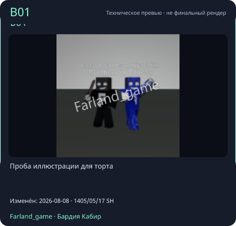](B01.md)

Бардия подготовил изображение своих и Армии Minecraft-персонажей для печати на праздничном торте. Он испытал аддон, но результат ему не понравился, и изображение не использовали.

## [B02 · Персонаж для задуманной книги](B02.md)

[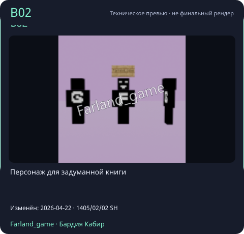](B02.md)

Бардия сделал виды персонажа с разных сторон для будущей книги с историей. Он намерен продолжить иллюстрации по мере развития навыков рисования.

## [B03 · Музыкальная анимация THE APEX и Gang Group](B03.md)

[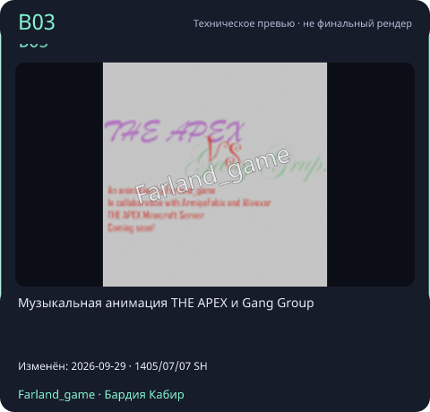](B03.md)

Одна из более поздних анимаций Бардии: музыка, команда THE APEX и персонажи Gang Group.

## [B04 · Эксперимент с Gang Group](B04.md)

[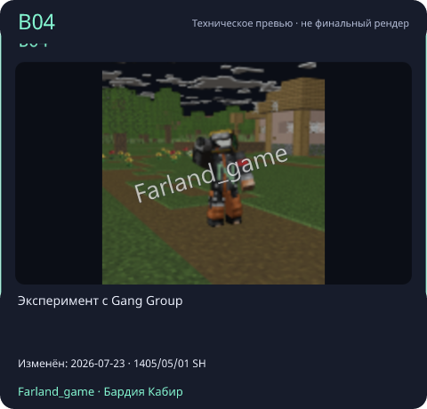](B04.md)

Короткая незавершённая анимация с персонажами Minecraft-ютуберов. Технические затруднения не позволили Бардии продолжить её в тот момент.

## [B05 · Эксперимент с огнём](B05.md)

[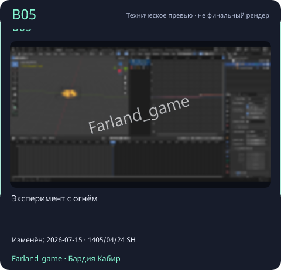](B05.md)

Незавершённый эксперимент по созданию огня в Blender.

## [B06 · Музыкальная сцена боя](B06.md)

[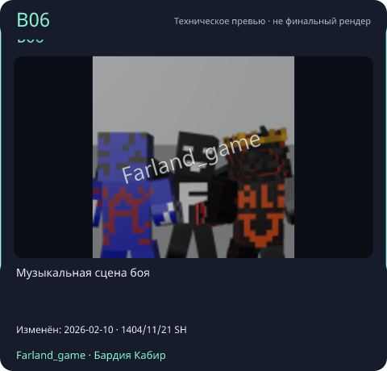](B06.md)

Любимая композиция вдохновила Бардию на анимацию с дракой. Часть сцены была сделана, но сложности с анимацией боя на том этапе остановили работу.

## [B07 · Ранняя заставка GoldBrain](B07.md)

[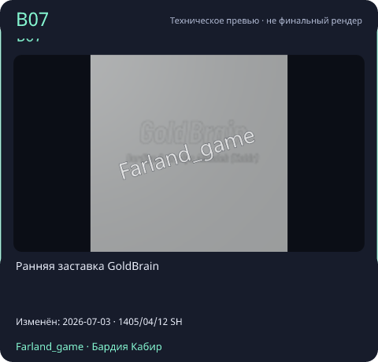](B07.md)

Первая проба заставки GoldBrain в Blender. Бардия остался недоволен результатом и позже сделал более удачную заставку средствами Flutter.

## [B08 · Повторно используемая модель оружия](B08.md)

[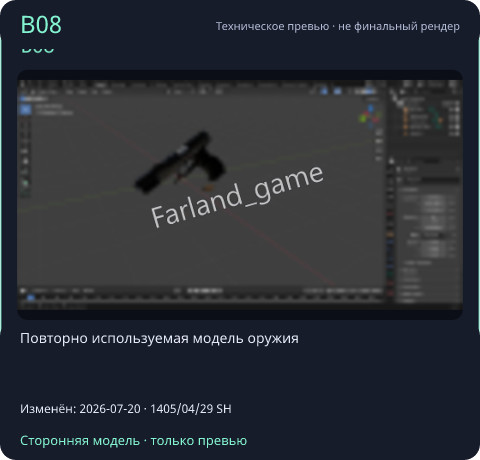](B08.md)

Файл модели оружия хранился для повторного использования в анимациях, чтобы не скачивать его заново. Это не подтверждение авторства самой сторонней модели; доступно только превью и сведения об источнике.

## [B09 · Head Bop](B09.md)

[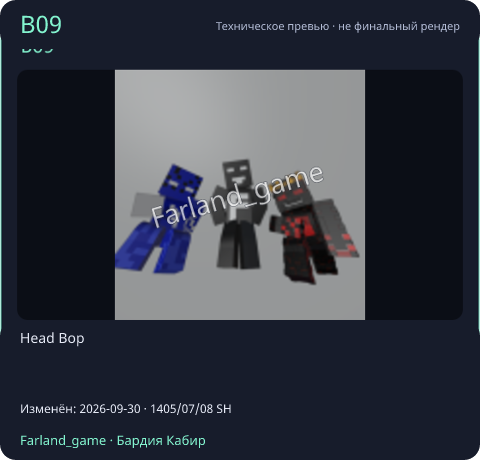](B09.md)

Blender-проект анимации Бардии Head Bop.

## [B10 · Хрустальная сфера для THE APEX](B10.md)

[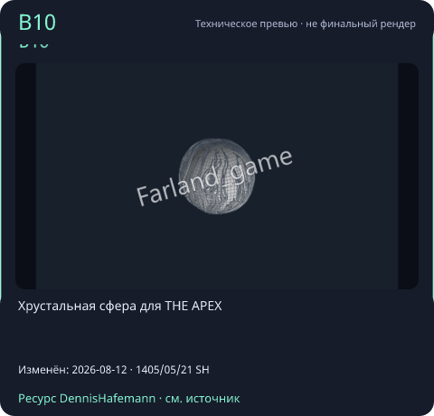](B10.md)

Сторонний ресурс сферы, использованный в приветственной сцене THE APEX B11. Автор ресурса — DennisHafemann; условия источника сохраняются, файл ресурса здесь не перераздаётся.

## [B11 · Приветственная сцена THE APEX](B11.md)

[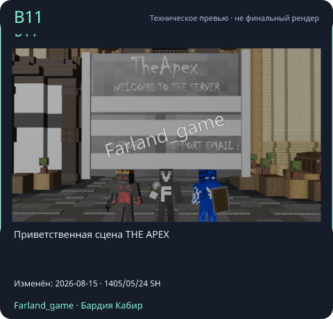](B11.md)

Изображение для входа на сервер THE APEX. Персонаж Бардии держит сферу, синий персонаж Армии — щит, а персонаж Али — меч.

## [B12 · Логотип THE APEX: T, X и ключ](B12.md)

[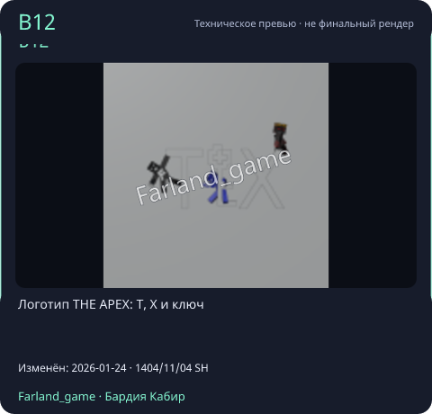](B12.md)

Законченный логотип для сайта THE APEX. Буква T взята из THE, X — из APEX. Ключ обозначает концепцию игры-эскейпрума.

## [B13 · Трейлер Vexland_Manhunt — в работе](B13.md)

[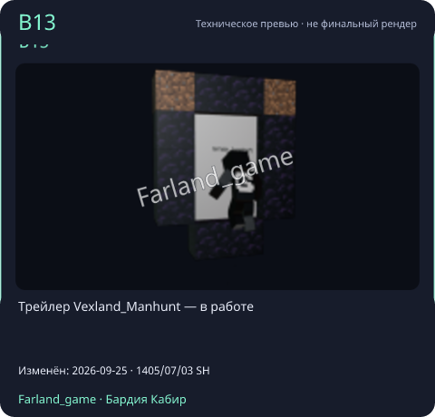](B13.md)

Анимированный трейлер плагина Vexland_Manhunt, изначально задуманный длинным. Бардия сделал часть, приостановился в том числе из-за вопросов авторских прав на музыку, но намерен продолжать и закончить. Он разрешил публикацию текущей рабочей версии; отдельно подтвердил право распространять включённую песню.

## [B14 · THE APEX — назначение файла не подтверждено](B14.md)

[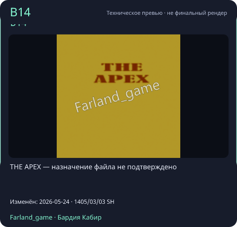](B14.md)

Автор не помнит точную первоначальную задачу этого файла. В превью видно THE APEX; возможно, это был баннер, оформление названия или анимация. Конкретное назначение не подтверждено.

## [B15 · Сцена первой анимации в Blender](B15.md)

[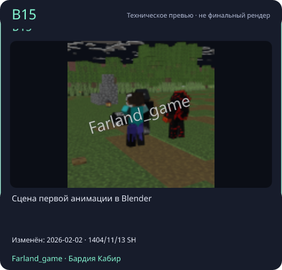](B15.md)

Один из двух сохранившихся файлов первой анимации Бардии именно в Blender. Изначально разные сцены хранились в четырёх Blender-файлах; два утрачены. Эти два показывают устройство раннего проекта.

## [B16 · Другая сцена первой анимации в Blender](B16.md)

[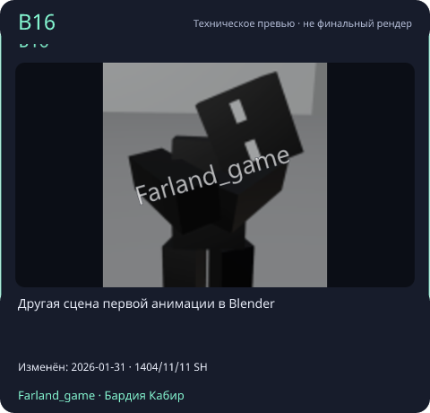](B16.md)

Второй из двух сохранившихся файлов первой Blender-анимации Бардии. Ещё два файла этой анимации утрачены. Речь идёт о первой работе в Blender, а не о более раннем 3D-эксперименте на телефоне.

## [B17 · Заказная анимация для урока права](B17.md)

[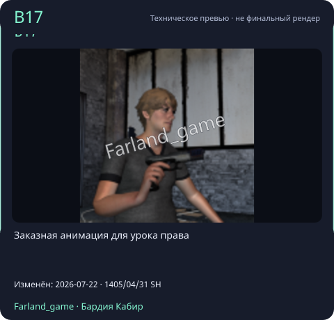](B17.md)

Оплаченный заказ для одного из преподавателей матери Бардии, которая работает юристом. Сцена иллюстрирует учебную ситуацию: персонаж намерен выстрелить вперёд, но из-за дрожания руки выстрел уходит вправо. Анимация предназначалась для объяснения сценария на занятии.

## [B18 · Анимация и последующий монтаж — отложено](B18.md)

[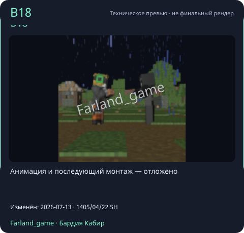](B18.md)

Бардия задумал анимацию, значительная часть окончательного вида которой должна была появиться при монтаже после Blender. Тогда у него ещё не было After Effects и не началось сотрудничество с Ашканом. Он сохранил частично сделанную сцену для возможного продолжения.

## [B19 · Тест аддона лица на Minecraft-персонажах](B19.md)

[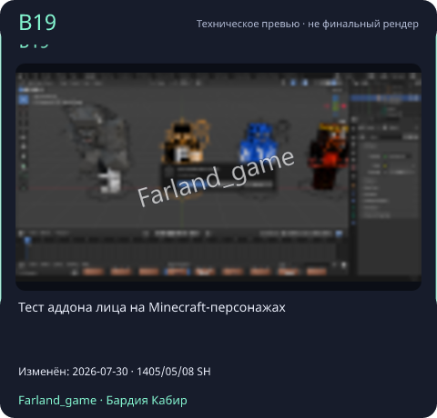](B19.md)

В этом файле Бардия проверял аддон, добавляющий глаза и рот. Он испытывал его на своём персонаже и персонажах Алирезы, Али и Амира, сохранив результаты экспериментов.

## [B20 · Заставка THE APEX, часть 1 — ранняя версия](B20.md)

[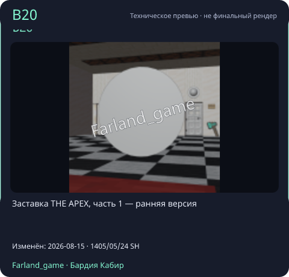](B20.md)

Первая из трёх задуманных частей заставки сюжетного Minecraft-эскейпрума THE APEX. Её планировали показывать плагином при начале игры. Ранняя версия отрендерена; Бардия хочет доработать походку и раннюю озвучку. По его памяти, было около 11 000 кадров и примерно 80 дней рендера на ноутбуке. Это стало важным уроком рендера и переноса проектов на другие системы.

## [B21 · Заставка THE APEX, часть 2 — не завершена](B21.md)

[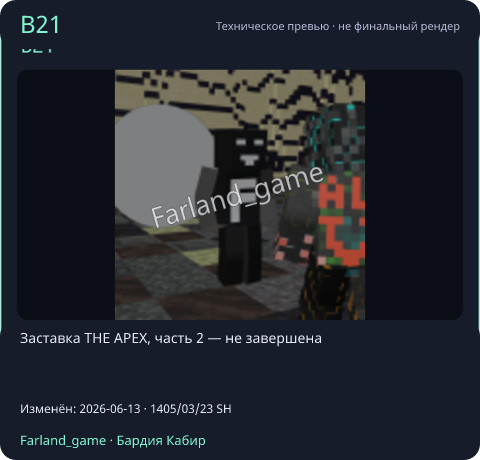](B21.md)

Продолжение B20 и вторая часть трёхчастной заставки THE APEX. Сцена не закончена; после приостановки Бардия к ней ещё не возвращался.

## [B22 · Сохранённая версия части 1 — предположительно](B22.md)

[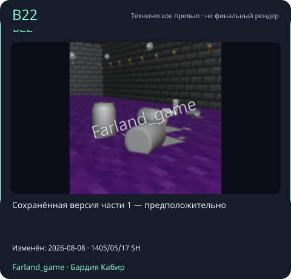](B22.md)

Бардия считает этот файл ещё одной сохранённой версией первой части заставки THE APEX, связанной с B20, а не отдельным проектом. Проверка обнаружила тот же диапазон кадров, но другое количество объектов и ресурсов; сохранённого аудио B20 в B22 нет. Обе версии оставлены для сравнения.

## [B23 · Трейлер и персонажи THE APEX](B23.md)

[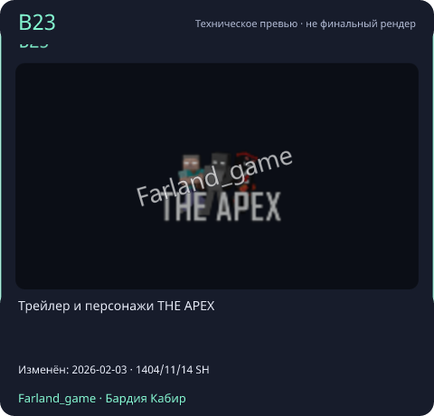](B23.md)

По словам Бардии, это его вторая анимация, сделанная в Blender: представление персонажей THE APEX и трейлер.

## [B24 · Риг Roblox-персонажа Ашкана](B24.md)

[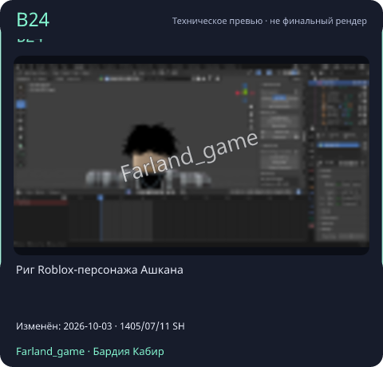](B24.md)

Эксперимент в Blender по подготовке и риггингу Roblox-персонажа Ашкана для будущей анимации.

## [B25 · Постер к танцу и столкновению персонажей](B25.md)

[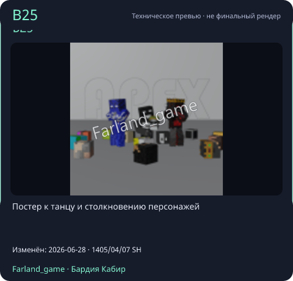](B25.md)

Сцена постера для B26: Бардия танцует, появляются Армия и Али, затем следует стилизованное столкновение без крови. По словам автора, итоговые видео и постер уже опубликованы, но отдельный файл монтажа эффектов постера утрачен. В этой сцене нет всех частей финальной обработки.

## [B26 · Minecraft: танец и столкновение](B26.md)

[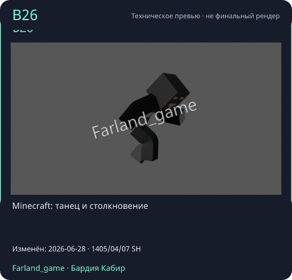](B26.md)

Исходник анимации, связанный с постером B25. Бардия танцует, появляются Армия и Али; затем следует стилизованное столкновение без крови. Итоговый ролик и постер уже публиковались. Движения переносились из смешанной библиотеки B27 со сменой скинов; не каждое движение создано Бардией с нуля.

## [B27 · Библиотека движений разных авторов](B27.md)

[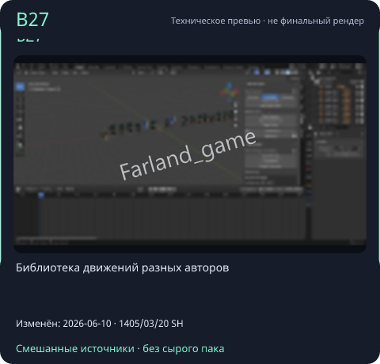](B27.md)

Рабочая коллекция, чтобы не создавать и не скачивать движения повторно, особенно для B26. Часть сделал Бардия, часть восстановлена по видео, часть получена из Mixamo. Нужные фрагменты переносились в сцену со сменой скинов. Это смешанная библиотека, а не полностью авторский пак; сырые данные Mixamo не распространяются здесь.

## [B28 · Разбивание бутылки — тест](B28.md)

[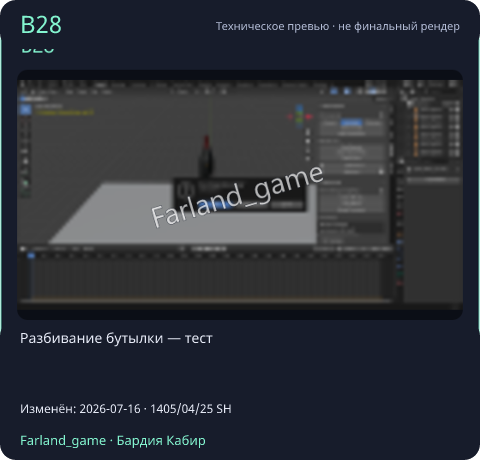](B28.md)

Отдельный тест разрушения бутылки для анимации, связанной с Ашканом. Бардии удалось сделать падение и разбивание, но в тот момент он не смог исправить начало разрушения уже на первом кадре. Это эксперимент с нерешённым таймингом, а не законченная симуляция. Точная связь с другими файлами про Ашкана не установлена.
